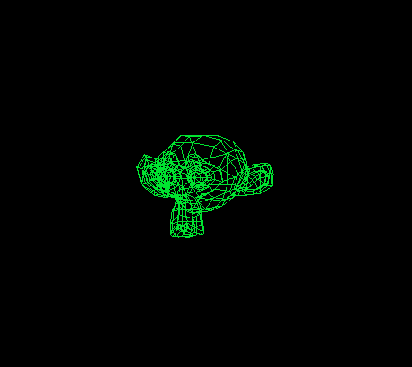
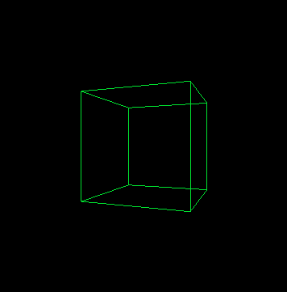

# cpu-rasterizer

读一个 OBJ 文件，把顶点投到屏幕上，用线框画出来。除了「在屏幕上画一个点」交给 raylib，其余自己写。

核心 169 行 C。没有矩阵库。



## 怎么跑

```bash
make
./game assest/Susan.obj
```

OBJ 解析用 [fast_obj](https://github.com/thisistherk/fast_obj)（单头文件），画点用 raylib。`-lraylib` 要能链接到 raylib：Linux 用包管理器装，Windows 用 MSYS2 的 mingw 包。

## 实现

投影没用矩阵，是透视除法：

```c
Vector2 Mapping(Vector3 pos) { return (Vector2){ pos.x / pos.z, pos.y / pos.z }; }
```

顶点先经 `RotationY` 绕 Y 轴转，再 `Mapping` 除 z，最后 `Screen()` 映射到屏幕坐标。raylib 原点在左上角、y 轴向下，所以 y 要取反。

`LinkVertex` 按 OBJ 的 face 索引把顶点两两连边，一条一条画线。

每帧先用 `FaceCenter` 算每个面的中心 z，排序，再画。



上面是 `Cube.obj`。八个顶点十二条边全都在，后面的边没有被前面的面挡住——因为只有线框，没有深度测试。画家算法排的是面的先后，解决不了边和边的穿插。

正确性没法自动验证，当时是每改一次跑一遍、看图对比。

## 已知限制

- 只有线框，没做面填充、z-buffer、纹理
- 画家算法排序，相交三角形会画错
- 没有背面剔除和裁剪，模型跑出视锥就歪
- 相机固定，没有 view 矩阵
